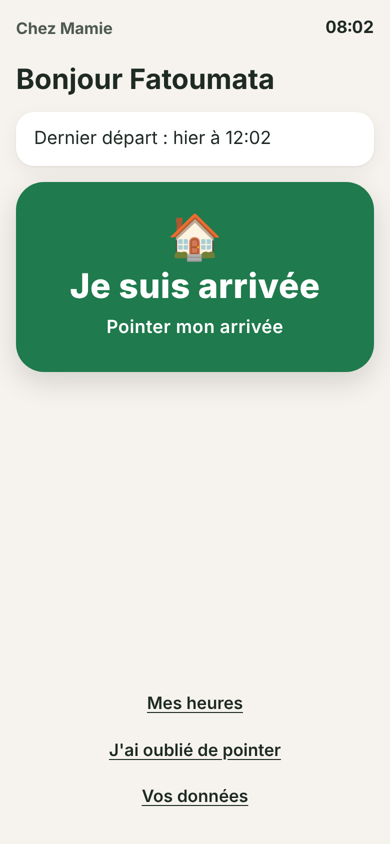
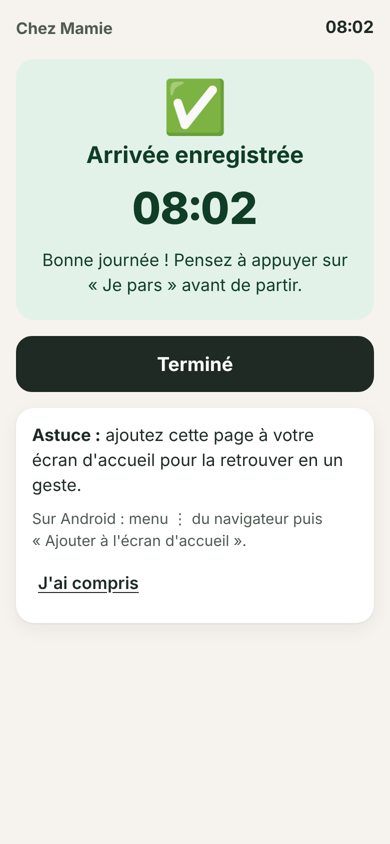
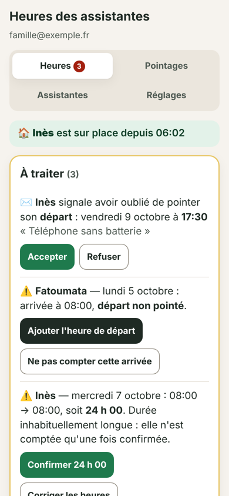

# Shifts — pointage géolocalisé pour assistantes de vie

Une petite web app pour une famille qui emploie des assistantes de vie au domicile d'une personne âgée.

- **Côté assistante** : un seul gros bouton « Je suis arrivée » / « Je pars ». Le serveur vérifie que le téléphone est bien au domicile, et l'heure enregistrée est celle du serveur.
- **Côté famille** : les heures du mois par assistante, un cadre « À traiter » (oublis, durées inhabituelles, demandes des assistantes) qui se règle en un geste, l'historique des corrections et un export Excel prêt pour la paie (CESU).

<p>
  
  
  
  
</p>

Démo vidéo (46 s) : [docs/demo.mp4](docs/demo.mp4)

## Le problème

- Des heures déclarées sans présence réelle au domicile, et des oublis de pointage.
- Une paie mensuelle à calculer à la main par des proches non techniques.

## Choix produit

| Problème | Réponse |
|---|---|
| Pointer depuis chez soi | Contrôle de distance **côté serveur** (150 m par défaut, réglable) et heure du serveur |
| Assistantes peu technophiles | Un lien personnel, aucun mot de passe, un seul bouton qui s'adapte à la situation |
| Oubli de pointage | L'assistante déclare l'heure réelle, la famille valide. Rien n'est payé sans validation. |
| Gardes de nuit et de 24 h | Seuil d'alerte réglable par assistante |
| Pas de réseau au domicile | La page s'ouvre hors ligne (service worker) et propose d'appeler, d'envoyer un SMS ou un WhatsApp à la famille |
| Confiance et litiges | Les pointages ne sont jamais supprimés (seulement annulés), avec un journal de qui a modifié quoi |
| RGPD | Position lue uniquement au moment du pointage, effacée après 60 jours, données effacées après 3 ans, écran « Vos données » |

## Architecture

- **Front** : HTML, CSS et JavaScript, sans framework ni étape de build (`site/`). PWA installable.
- **Back** : Supabase (Postgres). Toute la logique sensible passe par des fonctions SQL `SECURITY DEFINER`, avec des droits minimaux et la RLS activée. Les visiteurs n'ont accès qu'à quatre fonctions (`supabase.sql`).
- **Hébergement** : n'importe quel hébergement statique. Les en-têtes de sécurité (CSP stricte, etc.) sont fournis pour Netlify dans `site/_headers`.

```
site/          l'application à mettre en ligne
supabase.sql   la base de données (création ou mise à jour, rejouable)
GUIDE.md       guide d'installation et d'utilisation pour la famille
tests/         tests automatiques (base, dates et fuseau, captures d'écran)
docs/          captures et démo
```

## Installation

1. Crée un projet Supabase, puis exécute `supabase.sql` dans le SQL Editor.
2. Crée ton compte dans Authentication, puis rattache-le comme admin (voir `GUIDE.md`, étape 2).
3. Renseigne l'URL du projet et la clé `anon` dans `site/config.js`. La clé `anon` est publique par conception : la sécurité repose sur la base.
4. Mets en ligne le dossier `site/`. Sur Netlify, choisis `site` comme *Publish directory*.

## Tests

```bash
bash tests/run.sh          # environ 110 vérifications : sécurité, calculs, migration, installation neuve (PostgreSQL 16 local)
node tests/commun.test.js  # dates, changements d'heure, jours fériés, export CSV
python3 tests/apercu.py    # captures de tous les écrans + détection d'erreurs JS et de mise en page
```

## Limites connues

- Une personne qui a le lien d'une assistante et des compétences techniques peut envoyer une fausse position. L'app la signale (badges « position à vérifier » et « autre appareil ») mais ne peut pas l'empêcher.
- L'app calcule les heures, pas les majorations : elles dépendent de la convention collective.
